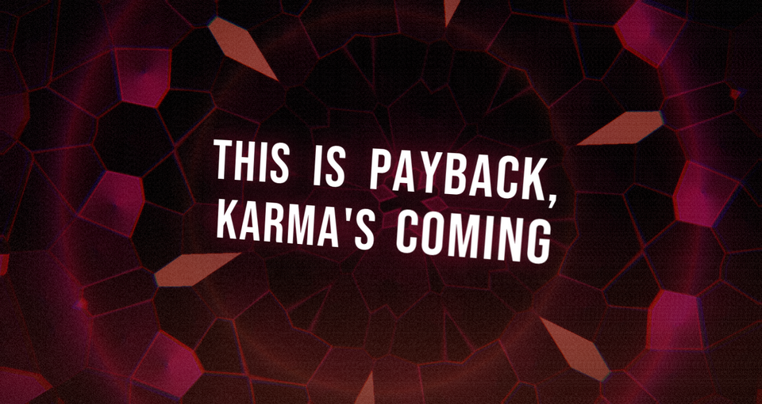
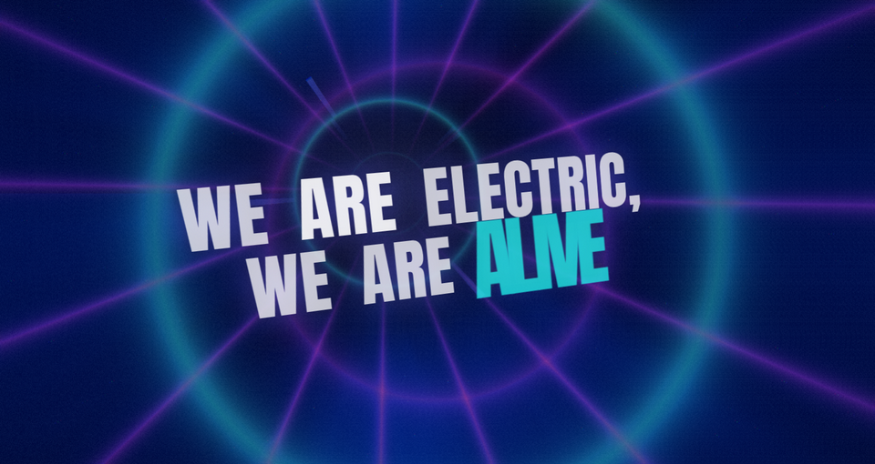
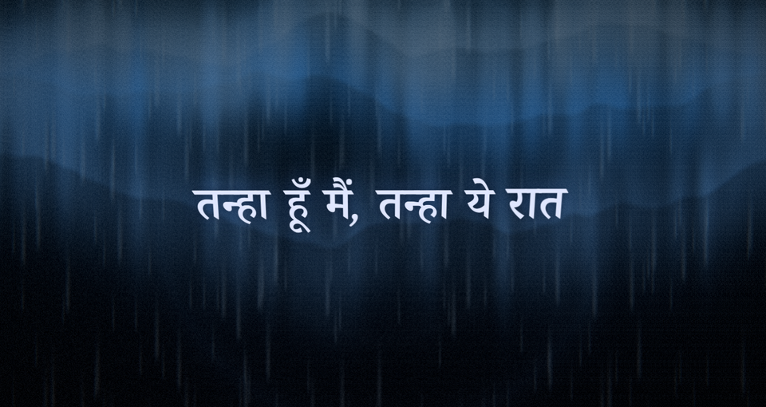

# Living Lyrics

[](LICENSE)


**Lyrics that move with the song, not just scroll under it.**

Living Lyrics watches whatever you're playing on your PC (Spotify, YouTube in a browser, VLC, anything that shows up in the Windows media pop-up), finds the lyrics, and puts them on screen in a 3D world that changes with the song. A revenge song gets fire, hard camera cuts and sharp type. A slow romantic one gets drifting light and a soft serif. The beat shakes the camera. The word being sung lights up as it's sung.

It works in English and ten Indian languages, in native script and in romanized spelling (Tanglish, Hinglish and so on).



## Why I made this

I liked the idea of the Cotodama Lyric Speaker, where the words feel like part of the music. Most lyric displays are a subtitle bar. I wanted something that reacts to the song, and that looks just as good for Tamil or Urdu as it does for English, which most lyric apps don't bother with. This is that.

It's inspired by the Cotodama Lyric Speaker and isn't connected to it in any way.

## What it does

- **Follows what you play.** It reads the Windows media session, so it works with any player that reports to Windows. You don't have to tell it which song is on.
- **Finds the lyrics.** Several sources are searched at once, and the best synced match wins. You can also drop your own `.lrc` file on the window.
- **Understands the song.** It works out the language, finds the verses and choruses, and judges the mood from the words (romance, heartbreak, revenge, hype, calm and so on) and from the live audio (key, tempo, energy).
- **Shows it properly.** Each line is real text placed in 3D space. A camera flies between lines, one of eight animated backgrounds sits behind them, and every line gets an entrance and an exit chosen to suit that moment of the song.
- **Reacts to the music.** Beats nudge the camera, loud parts glow, and quiet parts breathe.
- **Handles Indian scripts correctly.** Conjuncts like क्ष and க்ஷ stay in one piece, each language gets its own fonts, and Urdu runs right to left.

| | |
|---|---|
|  |  |
| *Hype (English): a tunnel of light* | *Romance (Tamil): aurora and soft type* |
|  |  |
| *Heartbreak (Hindi): rain on glass* | *Triumphant (Telugu): rays of gold* |


*Dark (Urdu): right to left, with the sung word lit up in the accent colour.*

These are frames from the built-in demo songs (sample lyrics I wrote for testing). Press `Ctrl+Shift+D` in the app to see them move.

## Getting started

**You'll need:** Windows 10 or 11 and a graphics card that supports WebGL. I built and tested it on Windows 11. Windows 10 uses the same media API so it should work, but I haven't tried it.

To run it from source you also need [Node.js](https://nodejs.org) 22.12 or newer.

```bash
git clone https://github.com/Guruganeshkannan/living-lyrics.git
cd living-lyrics
npm install        # also downloads the Electron binary
npm start          # builds and runs the app
```

Then play a song in any app. Press `D` to see what the app has detected.

To build a Windows installer and a portable `.exe`:

```bash
npm run dist       # output goes to release/
```

If you have a code-signing certificate, the build uses it. Put `guruganesh-codesign.pfx` and `pfx-password.txt` in `%USERPROFILE%\.living-lyrics-signing\` (or point `LL_SIGNING_DIR` at another folder). With no certificate you get an unsigned build, which Windows SmartScreen will warn about until you click through it. See [scripts/dist.mjs](scripts/dist.mjs).

## Using it

| Key | What it does |
|---|---|
| `[` / `]` | Move the lyrics 100 ms earlier or later for this song (saved) |
| `Shift` + `[` / `]` | Same, for all songs. Handy for Bluetooth speaker delay. |
| `M` | Cycle through moods by hand, then back to automatic |
| `R` | Look up this song's lyrics again |
| `F` / `Esc` | Toggle or exit fullscreen |
| `P` | Small always-on-top window |
| `D` | Debug panel: song, source, language, section, mood, camera, background, key, tempo, frame rate |
| `Ctrl+Shift+D` | Demo mode: cycle the built-in sample songs |

**Your own lyrics:** drop a `.lrc` or `.txt` file on the window to use it for the current song. You can also keep `Artist - Title.lrc` files in `Documents\LivingLyrics\lyrics\`. Your own files always win over online sources.

## Where the lyrics come from

The search runs these in parallel, gives up after 12 seconds, and keeps the best match. Synced lyrics beat plain ones, and a result whose length doesn't fit the track is thrown out.

| Source | On by default | Gives |
|---|---|---|
| [LRCLIB](https://lrclib.net) | Yes | Synced and plain lyrics, open and community-made |
| lyrics.ovh | Yes | Plain lyrics, as a last resort |
| Musixmatch | **No** | Sometimes word-by-word timing |
| NetEase Cloud Music | **No** | Synced lyrics |

Musixmatch and NetEase are switched off because they work through unofficial endpoints. Their terms may not allow this kind of use, and they can stop working without warning. If you want them, that's your call: edit `%APPDATA%\living-lyrics\settings.json` and add them to the list.

```json
{ "providers": ["lrclib", "lyrics.ovh", "musixmatch", "netease"], "searchTimeoutMs": 12000 }
```

Good matches are remembered. Songs with no lyrics, or only plain ones, are checked again after a day.

### Privacy

The song's title, artist, album and length are sent to the lyric services in order to find lyrics. Nothing else leaves your PC. There's no account, no analytics and no tracking. The audio is analysed on your machine to find the beat and key, and it is never recorded or sent anywhere.

### A note on lyrics

Lyrics belong to their writers and publishers. This project doesn't include any: it fetches them while you listen, for your own display. The demo songs are original text I wrote for testing.

## How it works

```text
 Player (Spotify, browser, VLC...)
        │  publishes title, artist, position to Windows
        ▼
 sidecar/media-watcher.ps1   ── reads the Windows media session every ~0.4 s
        │
        ▼
 Main process  ──►  finds lyrics (parallel search, cache, your own files)
        │           works out language, sections and mood from the words
        ▼
 Renderer      ──►  keeps a smooth song clock between position updates
                    listens to system audio for beat, energy and key
                    blends the lyric mood with the audio mood
                    plays the 3D scene: camera, background, text, particles
```

A few of the pieces worth knowing about:

- **Staying in sync.** Players report their position only now and then (Spotify is especially sparse). The app runs its own clock between reports and nudges it back gently instead of jumping. If a song is a little early or late, `[` and `]` fix it.
- **Mood, without any cloud or machine learning.** Word lists for 11 languages (about 2,700 entries) are combined with live music analysis: major or minor key, tempo and loudness. The lyrics set the starting mood and the audio takes over more as the song plays. Romanized word lists only switch on when that language is detected, so English songs aren't misread.
- **Word timing.** Most lyric files only time whole lines. The app learns how fast each song is sung and spreads each line's words across that pace. If a source gives real word timing, it uses that instead.
- **Choosing a move for each line.** There are 26 entrances and 17 exits. Each is scored against the moment: mood, energy, tempo, the line's own emotion, how long it's sung, how long it is, and the words in it. "Break" shatters, tears fall, fire burns to ash. Turning a line into particles is saved for section ends and keywords, so it stays special.
- **Keeping it smooth.** If the frame rate drops, the app lowers resolution, particle count and shader detail by itself, and raises them again when it can.

## Project layout

```text
src/
  main/        Electron main process: media watcher, lyric search, mood, cache
    providers/   One file per lyrics source
    data/lexicon/  Mood word lists, one JSON file per language
  preload/     Safe bridge between main and renderer
  renderer/    Everything you see
    audio/       System audio capture, beat and energy detection
    camera/      3D camera paths and fly-to moves
    layers/      Background shaders, particles, 3D text
    mood/        Key and tempo detection, mood blending
    text/        Fonts per script
    themes/      Each mood's look: colours, fonts, camera, backgrounds
    transitions/ Entrances, exits and the logic that picks them
  shared/      Types and helpers used by both sides
sidecar/       PowerShell script that reads the Windows media session
tests/         Unit tests
```

## Making it your own

- **Add or fix mood words:** edit `src/main/data/lexicon/<language>.json`. Each file has `moods`, `effects`, `negators` and `markers` (common words used to spot romanized text). `word:2` gives a word double weight. This is the easiest way to improve a language, and pull requests are very welcome.
- **Change how a mood looks:** edit its entry in `src/renderer/themes/themes.ts`.
- **Add a new motion:** add a preset in `src/renderer/transitions/presets.ts` and give it a profile in `TransitionEngine.ts`.

### Developing

```bash
npm run dev        # run with hot reload
npm test           # unit tests
npm run typecheck
```

For quick visual checks without playing music, start straight into a demo song with environment variables. In PowerShell:

```powershell
$env:LL_DEMO = "ta"; $env:LL_MOOD = "romance"; $env:LL_DEBUG = "1"; npm start
```

`LL_DEMO` picks the sample song (`en`, `en-revenge`, `ta`, `ta-rom`, `hi`, `te`, `kn`, `ml`, `ur`, `bn`), `LL_MOOD` forces a mood, and `LL_DEBUG` opens the debug panel.

## Known limits

- **Windows only.** It depends on the Windows media session and on Electron's system audio capture.
- **It's not light.** It's an Electron app drawing 3D graphics, and it uses roughly 800 MB of RAM while running (measured on my PC). I'd like to bring that down.
- **Mood comes from words, so it can miss.** Slang and dance-song lyrics sometimes read softer than they sound. The live audio pulls the mood toward the music over time, but lyrics still carry weight. Better word lists are the fix.
- **Most word timing is estimated.** It's learned from each song's pace and is usually close, but it isn't exact. Word-level timing only comes from sources that provide it.
- **Players that don't report to Windows are invisible.** Some games and older players don't. If two players are open, Windows decides which one counts as current.
- **The installer I build is signed with a certificate I made myself,** so Windows doesn't recognise the publisher.

## Ideas for later

These are ideas, not promises:

- A lighter build that uses far less memory.
- A simple version for Android TV or a Raspberry Pi, with lyrics and highlighting but without the full 3D show.
- Better mood word lists for more Indian languages and slang.

## Troubleshooting

- **Nothing is detected.** The player has to publish to Windows media controls. Press `D` to see what the app sees.
- **No lyrics.** Press `R`, or drop a `.lrc` file on the window. The line at the bottom of the screen says what happened.
- **"Electron uninstall" error.** Run `node node_modules/electron/install.js`.
- **`app.whenReady` is undefined.** Some editors set an `ELECTRON_RUN_AS_NODE` environment variable. Unset it and try again.

## Contributing

Bug reports, mood words, new languages and fixes are all welcome. Open an issue to talk it over first if it's a big change. Please run `npm test` and `npm run typecheck` before sending a pull request.

## Thanks to

- [LRCLIB](https://lrclib.net) for open, synced lyrics.
- [Three.js](https://threejs.org), [GSAP](https://gsap.com) (used under its free license), [Electron](https://www.electronjs.org) and [electron-vite](https://electron-vite.org).
- [Fontsource](https://fontsource.org) and the Noto, Baloo and other open fonts (SIL Open Font License) that make the Indian scripts look right.
- [sentiment](https://github.com/thisandagain/sentiment), based on the AFINN word list.

## License

[MIT](LICENSE), © 2026 Guruganesh.
